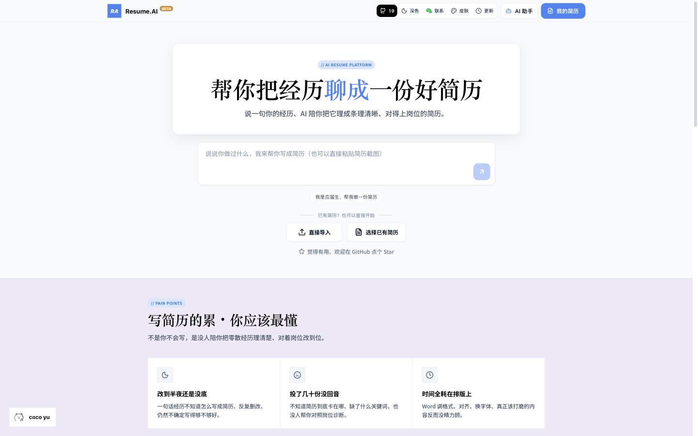
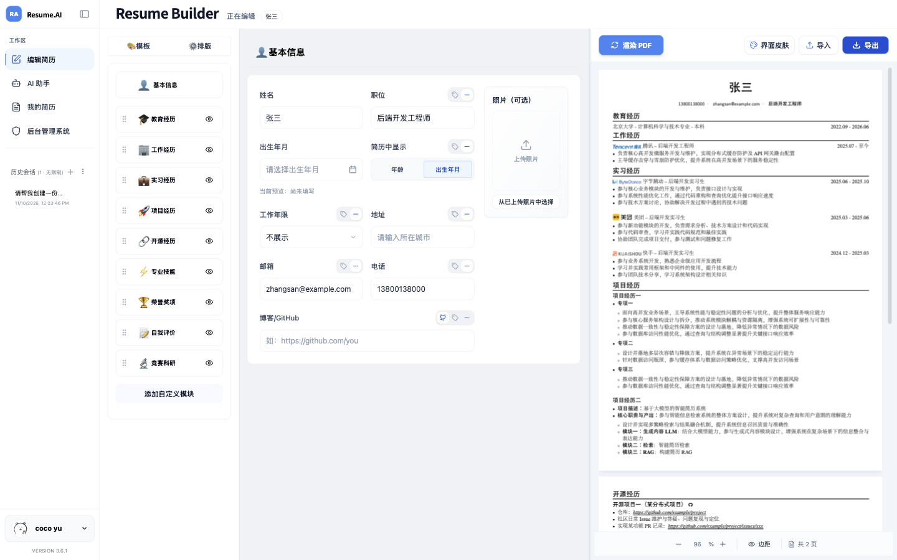
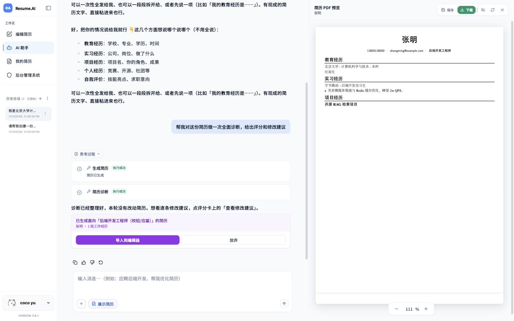
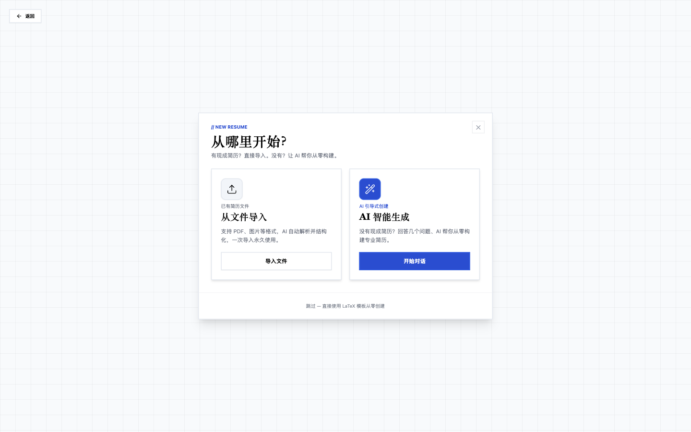
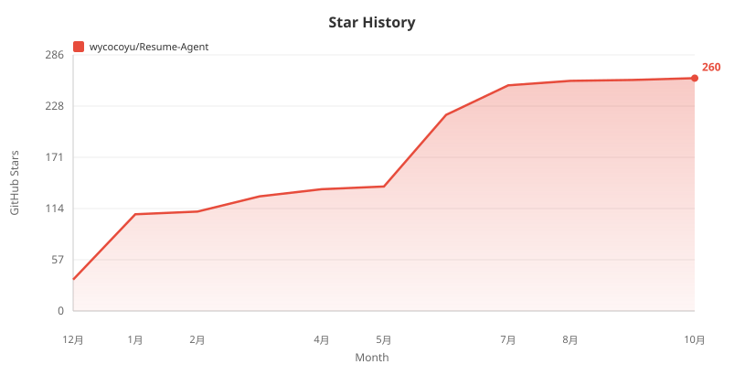

<div align="center">

# 🤖 Resume-Agent

### 帮你把经历聊成一份好简历：AI 生成、可解释诊断与 LaTeX 高清排版

<p>
  <a href="https://cococv.cn"></a>
  <a href="https://github.com/wycocoyu/Resume-Agent/stargazers"></a>
  <a href="LICENSE"></a>
</p>

<p>
  
  
  
  
  
  
</p>



</div>

---

## 📖 项目简介

**Resume-Agent（[cococv.cn](https://cococv.cn)）** 是一个面向中文求职场景的全栈 AI 简历平台，打通了从 **一句话对话生成 / PDF 与图片导入 → 可解释简历诊断与 ATS 检查 → 自然语言增量改写 → 双栏可视化排版与 LaTeX PDF 导出** 的全流程，让你把精力放回经历打磨本身，告别深夜反复调格式。

## ✨ 核心特性（v3.7）

| 模块 | 核心能力 |
|:--|:---|
| 🚀 **三种起点自由开局** | 支持一句话自然语言引导生成、上传已有 PDF / 图片简历自动解析（`glm-ocr` + `glm-4.6v`），或直接套用内置 LaTeX 标准模板从零编辑 |
| 💬 **AI 助手左聊右看** | 进程内 Agent 实时调用生成、诊断与修改工具，右侧同步渲染 PDF 预览，生成满意后一键「导入到编辑器」继续精修 |
| 🔍 **可解释诊断与 ATS 清单** | 评分依据逐字引用简历原文；针对目标岗位 JD 输出 **ATS 兼容检查清单**，精准点出空泛套话、量化缺失与技能掌握度短板 |
| 🛠️ **单条建议应用与缺口补齐** | 每条改进建议支持独立点击「帮我改这条」；涉及真实业务数据缺口的条目支持弹窗「补充信息并修改」 |
| 🎨 **双栏可视化精细排版** | 涵盖基本信息、教育、工作、实习、项目、开源、技能、获奖、自评、科研 10 大板块（支持自定义模块）；支持公司/学校 Logo、工作年限、独立字号、正文蓝字重点高亮与多级列表 |
| 📄 **LaTeX PDF 极速直连导出** | 服务端 XeLaTeX 高清编译，自动嵌入中文字体 `/ToUnicode` CMap（兼容无外部字映射的内置 PDF.js 阅读器），并归一化中英混排引号与连接符保障 ATS 解析 |
| 🔑 **可视化密钥配置与防呆热更新** | `/settings` 页面内置 DeepSeek 与智谱 GLM-OCR 密钥管理面板，支持一键连通性检测、跨平台格式防呆拦截与多 Worker 进程零重启热加载 |

## 📸 核心界面预览

<table>
<tr>
<td width="50%">
  <b>1. 双栏可视化编辑工作区（LaTeX 实时预览）</b><br/>
  <sub>左侧 10 大模块化表单与排版控制，右侧实时编译高清多页 PDF（内置学校与大厂 Logo）</sub><br/><br/>
  
</td>
<td width="50%">
  <b>2. AI 助手对话生成与实时预览</b><br/>
  <sub>左侧自然语言对话驱动简历生成与诊断工具链，右侧同步渲染最新 PDF 简历</sub><br/><br/>
  
</td>
</tr>
<tr>
<td width="50%">
  <b>3. 多路径快速开始向导</b><br/>
  <sub>支持 PDF/图片解析导入、AI 引导式问答创建、或直接以经典 LaTeX 模板起步</sub><br/><br/>
  
</td>
<td width="50%" valign="middle" align="center">
  <b>🌐 在线即刻体验</b><br/><br/>
  👉 <a href="https://cococv.cn"><b>访问 cococv.cn 体验完整功能</b></a><br/><br/>
  <sub>支持深色模式与多套清新界面皮肤一键切换</sub>
</td>
</tr>
</table>

## 🏗️ 技术架构与目录结构

| 目录 / 层级 | 技术栈 | 职责说明 |
|:--|:--|:--|
| `frontend/` | React 18 · TypeScript · Vite · Tailwind | 简历双栏可视化工作区、AI 助手对话流、多皮肤主题与简历管理 |
| `backend/` | FastAPI · Python 3.12+ · SQLAlchemy | 主业务 API、进程内 `backend/agent/` 智能体引擎、PDF 编译路由 |
| `web/` | Next.js 16 · BetterAuth · PostgreSQL | 统一身份认证服务（线上共享登录态，本地单机体验可按需启用） |
| **AI 模型层** | DeepSeek 官方（`deepseek-flash` / `deepseek-v4-pro`）· 智谱 GLM（`glm-ocr` / `glm-4.6v`） | DeepSeek 负责对话、诊断与结构化生成，智谱负责 PDF/图片 OCR 与版面识别 |
| **PDF 引擎** | XeLaTeX · CTeX | 服务端中英混排编译、Logo 嵌入渲染与 ATS 字符归一化 |

## 🚀 本地快速启动

### 1. 环境准备

- **Python** `3.12+`（推荐使用 [`uv`](https://github.com/astral-sh/uv) 管理依赖）
- **Node.js** `18+`
- **XeLaTeX**（PDF 编译必需）
  - macOS：安装 [MacTeX](https://www.tug.org/mactex/)
  - Ubuntu / Debian：`sudo apt install texlive-xetex texlive-lang-chinese fonts-noto-cjk`

### 2. 克隆仓库与安装依赖

```bash
git clone https://github.com/wycocoyu/Resume-Agent.git
cd Resume-Agent
pip install uv
uv pip install -r requirements.txt
cd frontend && npm install && cd ..
```

### 3. 配置环境变量

复制根目录 `.env.example` 为 `.env`：

```bash
cp .env.example .env
```

在 `.env` 中填入以下核心配置（也可先启动服务，再打开 `http://localhost:5173/settings` 在「AI 与 OCR 服务配置」面板可视化保存并一键检测连通性）：

```ini
DEEPSEEK_API_KEY=sk-xxxxxxxxxxxxxxxxxxxxxxxx
ZHIPU_API_KEY=xxxxxxxxxxxxxxxxxxxxxxxxxxxxxxxx.xxxxxxxxxxxxxxxx
JWT_SECRET_KEY=replace-with-any-random-string
```

| 变量名 | 是否必填 | 格式与用途说明 |
|:--|:--|:--|
| `DEEPSEEK_API_KEY` | 必填 | 以 `sk-` 开头；驱动 AI 对话、简历诊断与导入后的 JSON 结构化组装（[DeepSeek 开放平台](https://platform.deepseek.com/api_keys)） |
| `ZHIPU_API_KEY` | 推荐 | 格式为 `id.secret`（含英文点号 `.`）；驱动 PDF / 图片简历导入的 `glm-ocr` 版面识别，单份简历 OCR 成本约 `¥0.001`（[智谱开放平台](https://open.bigmodel.cn/usercenter/apikeys)） |
| `JWT_SECRET_KEY` | 必填 | 本地签名密钥，填入任意随机字符串即可 |

> 💡 数据库默认使用本地 SQLite，开箱即用。如需切换 PostgreSQL，可在 `.env` 中启用 `USE_POSTGRESQL=true` 与 `POSTGRESQL_URL`。前端默认连接 `http://127.0.0.1:9000`，如需自定义可执行 `cp frontend/.env.example frontend/.env.local`。

### 4. 启动前后端服务

启动后端 API 与内置 Agent（端口 `9000`）：

```bash
python -m uvicorn backend.main:app --host 127.0.0.1 --port 9000
```

另起终端启动前端开发服务器（端口 `5173`）：

```bash
cd frontend && npm run dev
```

启动后访问：

| 服务 | 本地地址 |
|:--|:--|
| 🖥️ **前端应用** | http://localhost:5173 |
| ⚙️ **后端 API** | http://127.0.0.1:9000 |
| 📖 **Swagger 接口文档** | http://127.0.0.1:9000/docs |

### 5. 构建与测试校验

前端类型检查与生产构建：

```bash
cd frontend && npm run build
```

后端单元测试：

```bash
python -m pytest backend/tests/ -q
```

## ⭐ Star History

<div align="center">
  
</div>

## 🤝 参与贡献

欢迎通过 [Issues](https://github.com/wycocoyu/Resume-Agent/issues) 反馈问题或提交 [Pull Requests](https://github.com/wycocoyu/Resume-Agent/pulls)。如果本项目对你有帮助，欢迎点亮右上角 ⭐ **Star** 支持！

## 📄 开源许可

本项目基于 [MIT License](LICENSE) 开源。
